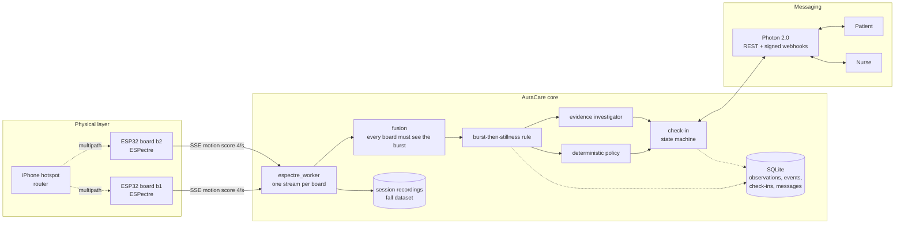
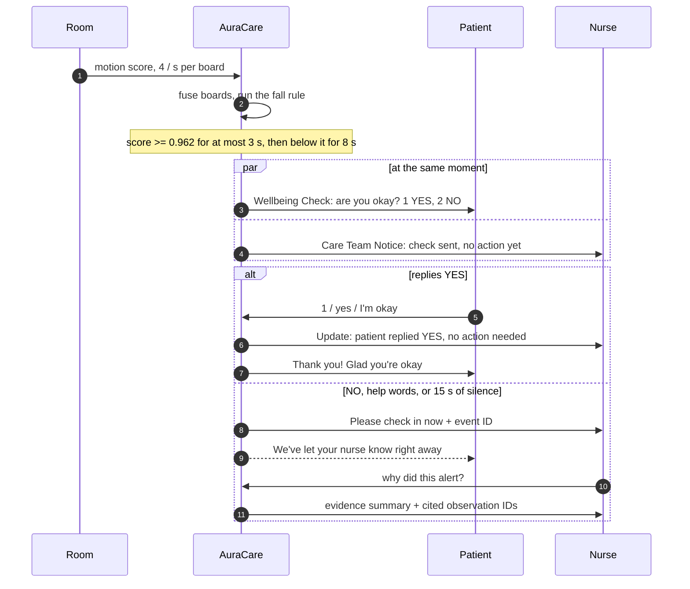

<div align="center">

# AuraCare

### Using Wi-Fi waves to watch over patients and alert their nurses.

*No cameras. No microphones. No wearables. Just radio, physics, and a text message.*


**HackPrinceton Fall 2026**

</div>

---

Every Wi-Fi router fills a room with radio waves. Those waves bounce off walls, furniture and people before they
reach a receiver. When a person moves, the bounces change, and the change is measurable down to the individual
frequencies inside the signal.

**AuraCare reads those changes.** ESP32 boards running ESPectre firmware listen to the room's Wi-Fi and turn the
signal into a motion score four times a second. AuraCare fuses the boards and watches for one specific shape in
time: **a short burst of strong movement (at most 3 s), followed by 8 s of stillness.** Walking past, rolling
over or getting up don't match it. When it sees a match, AuraCare doesn't sound an alarm. It asks:

> 💙 **AuraCare | Wellbeing Check**
>
> Hi! We noticed some unusual movement in your room and wanted to check on you.
>
> Are you okay?
>
> Reply 1: YES
> Reply 2: NO

At the same moment, the patient's nurse gets a calm heads-up, so the care team is never out of the loop:

> 🩺 **AuraCare | Care Team Notice**
>
> We noticed unusual movement in your patient's room and just sent them a wellbeing check.
> No action needed yet. We'll update you as soon as they reply.

Then the nurse hears how it ended, whatever happens: *"Good news: your patient replied YES"*, *"Your patient
replied NO and may need help. Please go check on them now."*, or *"Your patient hasn't answered yet."* The patient
gets a warm thank-you either way. The nurse can text back *"why did this alert?"* and get an answer built only
from recorded sensor data, with the IDs of the measurements it used.

> [!NOTE]
> AuraCare is a research prototype, tested only with consenting teammates and fictional patients. It is not a
> medical device and makes no fall-detection, clinical or diagnostic claims. It asks. It never diagnoses.

---

## Contents
1. [The signal path](#1-the-signal-path)
2. [Architecture](#2-architecture)
3. [Inside the pipeline](#3-inside-the-pipeline)
4. [Results](#4-results)
5. [Fail-safe by design](#5-fail-safe-by-design)
6. [Tech stack](#6-tech-stack)
7. [Quickstart](#7-quickstart)
8. [Running the demo](#8-running-the-demo)
9. [API](#9-api)
10. [Repository map](#10-repository-map)
11. [Limitations and roadmap](#11-limitations-and-roadmap)
12. [Credits](#12-credits)

---

## 1. The signal path

```
        ))) ))) )))                                                    ┌─────────────────┐
   ┌──────────────┐    2.4 GHz, ch 6, 20 MHz     ┌────────────────┐    │ motion score    │
   │  iPhone      │  ~~~~~~~~~~~~~~~~~~~~~~~~~>  │ ESP32 board b1 │───>│ 4 / s, SSE      │──┐
   │  hotspot     │  ~~~~~~ bounce off  ~~~~~~>  │ ESPectre fw    │    └─────────────────┘  │
   │  (router)    │  ~~~~~~ walls, people ~~~~>  ┌────────────────┐                          │  fusion:
   └──────────────┘  ~~~~~~~~~~~~~~~~~~~~~~~~~>  │ ESP32 board b2 │───> same ────────────────┤  a burst counts only
                                                 └────────────────┘                          │  if every board saw it
                                                                                             v
   ┌───────────┐   ┌────────────────┐   ┌──────────────────┐   ┌──────────────────────┐   ┌──────────┐
   │ iMessage  │<──│ check-in state │<──│ policy: opt-in,  │<──│ burst <= 3 s, then   │<──│ fused    │
   │ patient   │   │ machine (15 s) │   │ sensor fresh, no │   │ 8 s still  -> event  │   │ level    │
   │ + nurse   │   └────────────────┘   │ open check-in    │   └──────────────────────┘   └──────────┘
   └───────────┘                        └──────────────────┘
```

Under the hood each board measures the **channel state information (CSI)** of the Wi-Fi link: one complex number
per OFDM subcarrier, describing how that slice of the signal was weakened and shifted on its way across the room.
ESPectre's on-board detector condenses those changes into one motion score per evaluation, calibrated for the room.
A person throwing themselves to the floor spikes it. A person lying still barely moves it.

## 2. Architecture





## 3. Inside the pipeline

### 3.1 The board motion score
Each ESP32 runs **ESPectre** firmware and keeps a Wi-Fi link busy with the hotspot (about 100 packets per second
of ping traffic). On the board, ESPectre turns the CSI of those packets into a motion score and streams one
evaluation every 250 ms as Server-Sent Events: `event: motion`, `data: {"timestamp_ms", "state", "score"}`.
`monitoring/espectre_worker.py` holds one stream per board, reconnects with backoff, and never opens the raw CSI
stream (that would pause the on-board detector). The threshold **0.962** was calibrated by the team in the demo
room: it fires on aggressive motion and ignores shifting, breathing and rolling over.

### 3.2 Two boards, one opinion
With two boards (one on each side of the bed), a burst only counts if **every board crossed the threshold within
1 s**. Stillness needs every board below it. One board alone reads `mixed`, so someone walking past one board
can't start a fall. A board that goes silent for more than 1.5 s is dropped from the vote, and the rule restarts
rather than treat silence as stillness.

### 3.3 The fall rule
An alert is a shape in time, not a single reading (`monitoring/burst_rule.py`, from the team's WiCare app):

```
MONITORING --score >= 0.962--> BURST --score < 0.962--> STILLNESS --8 s--> FALL -> event -> check-in
                                 |                          |
                                 | burst > 3 s              | movement again (after a 0.75 s grace)
                                 v                          v
                              MOVEMENT (walking, getting up: no alert) --1 s quiet--> MONITORING
```

$$\text{fall} \iff \underbrace{t_\text{end} - t_\text{start} \le 3\,\text{s}}_{\text{burst}} \ \wedge\ \underbrace{s_t < 0.962\ \ \forall t \in [t_\text{end},\ t_\text{end} + 8\,\text{s}]}_{\text{stillness}}$$

Every event records the peak score, the burst length and the stillness length, so the nurse's "why did this
alert?" answer can quote them.

### 3.4 Every session is a dataset
Each live run is saved to `data/sessions/<time>.jsonl` (`t, board, score, device_ms` per sample, the same format
as the WiCare app). Any recording replays through the full pipeline in real time
(`--replay`), so every fall the team performs becomes a test case for tuning the rule and, later, training a model.

### 3.5 The decision layer
A deterministic policy, not a model, decides whether a human gets a message. Before texting anyone it checks
that the sensor is fresh, the participant opted in, the event source is allowed, and no check-in is already open.

| Patient reply | Outcome |
|---|---|
| `1`, `yes`, `ok`, `I'm okay`... | closed as *acknowledged* (not proof of safety); nurse told "no action needed"; patient thanked |
| `2`, `no`, `help`, or "fell", "hurt", "can't get up", "dizzy"... | nurse asked to check in now; patient told the nurse knows |
| `away` / `3` (understood, not advertised) | closed as *away*; nurse updated |
| anything else | *ambiguous*: patient asked again, nurse asked to review, check-in stays open |
| no reply in 15 s | nurse asked to check in |
| message undeliverable | nurse asked to check in directly |

The nurse is told the moment the patient is texted, so a check-in never happens behind the care team's back.

### 3.6 The evidence investigator
Every event gets a report assembled only from stored numbers: sensor health, activity 30 s before and after,
signal coverage, the check-in timeline. Every sentence cites the observation IDs it came from. Nurse
questions are routed by keyword to the right part of that report. **There is no language model anywhere in the
loop, so there is nothing to hallucinate.**

### 3.7 Messaging
Outbound: four Photon 2.0 REST calls (resolve user, find their assigned iMessage line, open the direct space,
send) with idempotency keys, so a retry can never double-text. Inbound: Standard Webhooks signatures
(HMAC-SHA256 over `id.timestamp.body`, 5 minute window, secret rotation supported) verified before a single byte
is processed. Recipients are resolved by role from server config: no code path can text an arbitrary number.

## 4. Results

Before switching to ESPectre's on-board score for the live demo, we built and evaluated a full raw-CSI
machine-learning path. It stays in the repo (`DETECTOR=score`) as the base for a learned fall model.

### 4.1 Public benchmark: WiFall
Five activities (fall, jump, sit, stand, walk), 926 usable 3 s clips, 10 participants.
**Leave-one-participant-out**: every score is on a person the model has never seen.

| Model | 5-class macro-F1 | Fall vs rest bal. acc | Fall precision |
|---|---|---|---|
| Majority baseline | 0.13 | 0.50 | - |
| Random forest, handcrafted features | 0.41 | 0.69 | 0.76 |
| 1D CNN | 0.49 | 0.78 | 0.87 |
| **RF + CNN ensemble** | **0.51** | **0.78** | **0.86** |

**Split conformal prediction** on the ensemble ($\alpha = 0.1$): coverage **91.5%**, average set size 2.85, and
"fall" inside the prediction set for **94.6%** of real falls. If the set holds more than one label, the model
abstains.

### 4.2 Our room (raw CSI, RuView firmware, 2 nodes)
13 one-minute recordings: empty room, one and two people still, one and two people moving, plus sit-down /
stand-up and jump sessions driven by **28 spoken, timestamped prompts**.

**The WiFall model did not transfer.** New hardware, new room, new sampling rate. In the empty room it ranked
"fall" first in 23% of windows and never committed to a single label. It is kept as a benchmark and is **never
used for alerts**.

**A model trained in the room did.** Train on recording 1 of each state, test on recording 2, then swap:

| Held-out task | Balanced accuracy |
|---|---|
| Moving vs still / empty | **0.84** |
| Occupied vs empty | 0.81 |
| People count (0 / 1 / 2) | 0.64 |
| Exact state (5 classes) | 0.57 |

| Alert rule on held-out score streams | Result |
|---|---|
| Movement detected after prompted actions | **28 / 28** |
| False alerts across all 13 recordings, including every sit-down and jump | **0** |

People counting at 0.64 is too weak to act on, so it is never allowed to cancel an alert.

### 4.3 Research path: from raw CSI to a movement score

#### Decoding the radio
Almost every packet arrives as 256 signed bytes (802.11n): an L-LTF block and an HT-LTF block, each holding 64 subcarriers as
`[imag, real]` pairs. AuraCare takes the L-LTF block (`raw[0:128]`) and rebuilds the complex channel:

$$H_k = \text{real}_k + j \cdot \text{imag}_k, \qquad k \in \{0..31,\ -32..-1\}$$

It then drops the DC and guard subcarriers (12 of them) and reorders the remaining 52 into frequency order
$[-26..-1,\ +1..+26]$. The order was verified, not assumed: a lag-2 phase-continuity test compares the phase jump
across the middle of the band against the typical jump between neighbours. The correct layout won on
**26 out of 26** node recordings.

#### Surviving real hardware
Spec sheets said 45 to 50 packets per second. We measured the room instead:

| Signal property | Measured |
|---|---|
| Packets delivered per node | **~29 / s** |
| Packets lost in transit (sequence gaps) | **~34%** |
| Longest gap | **0.8 s** |
| Packets with subcarriers 0 and +1 zeroed by the chip | **100%** |

So nothing in AuraCare assumes a fixed rate. Every window is cut from laptop receive timestamps, checked with
sequence numbers, and interpolated onto a 50 Hz grid:

- **length:** 2.96 s (148 samples)
- **coverage:** at least 60% of the expected packets
- **max gap:** 0.3 s, otherwise the window is discarded and nothing is inferred

The zeroed subcarrier +1 is filled from its neighbour instead of feeding the model a fake zero.

#### Turning waves into motion
For each node and each window, AuraCare computes 23 motion features from the amplitude matrix
$X \in \mathbb{R}^{148 \times 52}$:

| Family | What it captures |
|---|---|
| Subcarrier spread | how much each frequency fluctuates over the window |
| Step energy | $\lvert X_{t+1} - X_t \rvert$: how violently the channel changes between samples |
| Energy timing | where in the 3 s the motion peaks, and early vs late energy |
| Principal component | share of variance in the dominant motion direction (SVD) |
| Spectral bands | power of that component in 0.3-1, 1-2, 2-4, 4-8 and 8-20 Hz bands |
| Robust z-scores | fraction of samples far outside the window's own median |

No absolute signal level is used, so the model reacts to *movement*, not to where the boards happen to sit.

#### A room-trained movement score
Both nodes' features are concatenated (46 values) and passed to a random forest trained on recordings of this
exact room. The output is one number per second:

$$s_t = P(\text{moving} \mid \phi(X^{(2)}_t) \oplus \phi(X^{(3)}_t)), \qquad \tilde{s}_t = \text{median}(s_{t-2},\ s_{t-1},\ s_t)$$

#### Its temporal rule
An alert is a shape in time, not a single prediction:

$$\exists\, t_0:\ \tilde{s}_{t_0} \ge 0.8 \quad\text{and}\quad \tilde{s}_t \le 0.4\ \ \forall\, t \in [t_1,\ t_1 + 8\,\text{s}],\ t_1 > t_0$$

with no return to movement in between. If the sensor feed goes stale, the detector resets: **missing data is
never treated as stillness.**

## 5. Fail-safe by design

37 automated tests, one or more per rule:

| Guarantee | Tests |
|---|---|
| Stale or offline sensor = "unavailable", never "person is still"; gaps reset the detector | `test_stale_sensor_*`, `test_gap_resets_detector` |
| Replayed or synthetic data never texts anyone outside demo mode; no opt-in, no message | `test_replay_*`, `test_no_opt_in_*`, `test_room_replay_is_demo_only` |
| One check-in per event; duplicate webhooks and sends ignored | `test_abrupt_*`, `test_duplicate_webhook_ignored` |
| OK acknowledges; help words escalate; free text never closes a check-in | `test_ok_*`, `test_help_*`, `test_mixed_*`, `test_ambiguous_never_closes` |
| Timeouts and delivery failures escalate | `test_timeout_escalates`, `test_delivery_failure_recorded` |
| Webhooks need a valid, fresh signature; rotation works; own messages ignored | `test_unknown_sender_and_bad_signature`, `test_signature_rotation_and_stale_timestamp`, `test_own_agent_message_ignored` |
| Reports cite only real IDs; nurse answers are grounded; replays are labelled | `test_report_*`, `test_stale_sensor_report_*`, `test_caregiver_question_gets_grounded_answer`, `test_replay_labelled` |
| Activity labels attach to events only after live validation | `test_ml_only_attached_after_validation` |
| A fall needs a short burst then 8 s still; long bursts (walking), movement during stillness and signal gaps never alert; every board must see the burst | `test_short_burst_*`, `test_long_burst_is_walking_not_a_fall`, `test_movement_during_stillness_cancels`, `test_signal_gap_*`, `test_fusion_*`, `test_burst_mode_*` |
| Windows follow the real packet rate; layout check survives the zeroed subcarrier | `test_window_*`, `test_lag2_*` |

**Privacy:** no video, no audio, no MAC addresses, phone numbers only in a local `.env`, roles (patient / nurse)
instead of numbers everywhere else, consenting teammates only.

## 6. Tech stack

| Layer | Technology | Role |
|---|---|---|
| Radio | iPhone 15 Pro hotspot, 2.4 GHz ch 6, 20 MHz HT | transmitter |
| Sensors | ESP32 boards, ESPectre firmware | on-board CSI motion score, 4 / s per board |
| Streaming | Server-Sent Events, one reader thread per board | live scores, reconnect, two-board fusion |
| Fall rule | burst-then-stillness state machine | burst <= 3 s, then 8 s still, every board must agree |
| Signal processing (research) | NumPy, SciPy | raw-CSI subcarrier mapping, windowing, SVD, FFT |
| Machine learning (research) | scikit-learn (random forest), PyTorch (1D CNN) | room movement score; WiFall benchmark ensemble |
| Uncertainty | split conformal prediction | calibrated prediction sets and abstention |
| Backend | FastAPI, Uvicorn, SQLite | ingestion, rules, policy, check-ins, evidence store |
| Reasoning | deterministic investigator + keyword reply parser | grounded nurse answers, no LLM |
| Messaging | Photon 2.0 REST API, Standard Webhooks | iMessage check-ins and replies |
| Networking | Cloudflare Tunnel | public HTTPS for webhooks |
| Testing | pytest | 37 safety and correctness tests |

## 7. Quickstart

Python 3.10+ on macOS or Linux.

```bash
git clone https://github.com/NullPranaya/Wi-Fall.git && cd Wi-Fall
python -m venv .venv && source .venv/bin/activate
pip install -r requirements.txt
cp .env.example .env
pytest -q
```

| `.env` variable | Meaning |
|---|---|
| `PATIENT_ADDRESS`, `CAREGIVER_ADDRESS` | test phone numbers, E.164 (`+1...`) |
| `PARTICIPANT_OPT_IN` | must be `1` before anyone is messaged |
| `DEMO_MODE` | `1` lets replayed or synthetic events text test numbers |
| `EXPECTED_ACTIVE` | `0` for the demo: a quiet room alone never triggers a text |
| `CHECKIN_TIMEOUT_S` | seconds before silence escalates to the nurse (demo: 15) |
| `PHOTON_MODE` | `mock` logs messages, `api` sends them |
| `PHOTON_PROJECT_ID`, `PHOTON_PROJECT_API_KEY` | from the Photon dashboard |
| `PHOTON_WEBHOOK_SECRET` | the `whsec_...` secret from the webhook destination |
| `ESPECTRE_BOARDS` | `b1=http://<board ip>:62587/espectre/v1,b2=...` |
| `BURST_THRESHOLD`, `BURST_MAX_S`, `BURST_STILL_S` | fall rule: 0.962, 3 s, 8 s |
| `DETECTOR` | `burst` (live demo, default) or `score` (raw-CSI research path) |

**Photon in four steps**
1. Dashboard: copy the **Project id**, create an **API key**.
2. **iMessage > Add someone to the line** for both phones. Each phone texts its assigned line once.
3. `cloudflared tunnel --url http://127.0.0.1:8000`, then **Webhooks > Add a destination** with
   `<tunnel url>/webhooks/photon` and all events. Save the secret.
4. `PHOTON_MODE=api`, restart the backend.

## 8. Running the demo

```bash
# terminal 1: backend
uvicorn backend.main:app --host 127.0.0.1 --port 8000

# terminal 2: public URL for replies (update the Photon webhook if it changes)
cloudflared tunnel --url http://127.0.0.1:8000

# terminal 3, pick one
python -m monitoring.espectre_worker                              # live boards from ESPECTRE_BOARDS, records the session
python -m monitoring.espectre_worker --replay data/sessions/<file>.jsonl   # replay a recorded session
python -m monitoring.csi_worker --synthetic                       # labelled fallback, no boards
```

Live output (two boards):
```
20:14:49 board b1: connected
20:14:49 board b2: connected
20:14:52 score 0.200 STILL
20:14:53 score 1.300 MIXED          <- only one board has seen the burst so far
20:14:54 score 1.300 MOTION         <- both boards: the burst counts
20:14:55 score 0.100 STILL
  ...
  EVENT evt_cdcb15967f burst_then_stillness {'action': 'routine_checkin', ...}
```
The board allows two stream clients at most: don't run another app against the same boards during the demo.

Reproduce every number in this README:
```bash
python -m ml.data data/raw/WiFall data/clips.npz
python -m ml.train_rf data/clips.npz --rate 50 && python -m ml.train_cnn && python -m ml.evaluate
python -m ml.eval_auracare <room dataset>      # WiFall model in our room
python -m ml.eval_room <room dataset>          # held-out room models
python -m ml.room_motion train <room dataset>  # research movement model
```

## 9. API

| Method | Path | Purpose |
|---|---|---|
| `POST` | `/ingest/observation` | one movement score (from the worker) |
| `POST` | `/ingest/ml` | latest activity-model window (experimental) |
| `GET` | `/sensors/{id}/health` | is the feed fresh and ready |
| `GET` | `/sensors/{id}/baseline` | active detector thresholds |
| `GET` | `/activity/history` | recent movement scores |
| `GET` | `/events`, `/events/{id}` | events with evidence IDs and policy decision |
| `GET` | `/events/{id}/checkin` | check-in state and timeline |
| `GET` | `/events/{id}/investigations` | evidence reports |
| `POST` | `/checkins`, `/investigate` | policy-checked manual check-in, re-run investigation |
| `POST` | `/webhooks/photon` | signed inbound iMessage events |

Interactive docs at `http://127.0.0.1:8000/docs`.

## 10. Repository map

```
backend/         FastAPI app, settings, SQLite store, service layer
monitoring/      espectre_worker (live boards, recording, replay), burst rule + fusion, policy; csi_worker (research)
sensors/         subcarrier mapping, layout checks, timestamp windowing, sensor health
ml/              WiFall pipeline (RF, CNN, conformal), room dataset loader, room movement model, evaluations
investigation/   evidence investigator and grounded nurse answers
photon/          Photon 2.0 client, webhook verification, check-in state machine, reply parser
models/          room movement model, calibration, conformal threshold
evaluation/      saved metrics behind every number above
sim/             WiFall replay sensor
tests/           37 tests
```

## 11. Limitations and roadmap

**Honest limits**
- **Fall recordings are just starting.** The rule's numbers (0.962, 3 s, 8 s) were tuned by the team on the real
  board in the demo room; the session recorder now collects real falls (onto a crash mat) to measure it properly.
- **One room.** The threshold is calibrated per room; a new room needs a new calibration.
- **The hotspot is part of the sensor.** If someone picks up the phone, the link changes.

**Next**
- multi-day recordings, furniture changes, more rooms
- per-person routines instead of fixed thresholds
- a learned fall model on the recorded sessions, starting from the raw-CSI research path
- a nurse dashboard across multiple rooms and patients

## 12. Credits

- ESPectre: ESP32 Wi-Fi motion sensing firmware running on the boards
- [WiCare](https://github.com/duna-akin/WiCare): the team's board client, fusion and burst-then-stillness rule
- [WiFall](https://github.com/RS2002/WiFall): public CSI activity dataset used for the benchmark
- [RuView](https://github.com/ruvnet/RuView): CSI firmware for the research recordings, and the 3D room view
- [Photon](https://photon.codes): iMessage messaging API
- NumPy, SciPy, scikit-learn, PyTorch, FastAPI, Uvicorn, pytest
