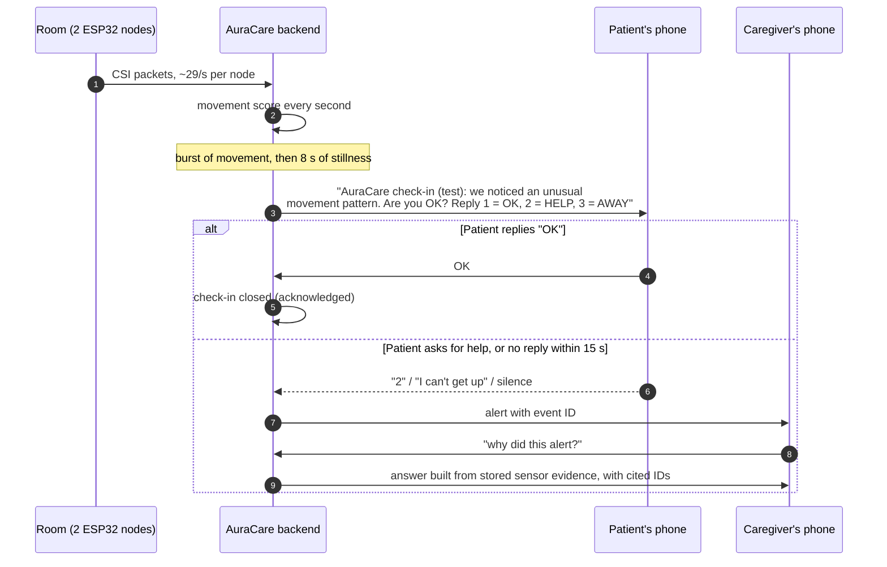
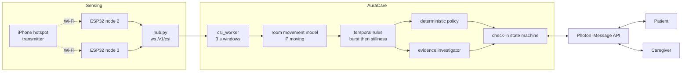

# AuraCare

**Camera-free check-ins for older adults who live alone.** AuraCare watches how Wi-Fi signals move through a room,
notices when a burst of movement is followed by stillness, and texts the person a simple question over iMessage:
*"Are you OK?"* If they answer "OK", nothing else happens. If they ask for help, or don't answer, their caregiver
gets a message with the evidence behind the alert.

No cameras. No microphones. No wearables to forget. No paid AI APIs. Built for HackPrinceton Fall 2026.

> **Scope.** AuraCare is a research prototype tested only with consenting teammates and fictional patients.
> It is not a medical device and makes no fall-detection, clinical or diagnostic claims. Its job is to *ask*,
> not to diagnose.

---

## Contents
- [Why](#why)
- [What happens in the demo](#what-happens-in-the-demo)
- [How it works](#how-it-works)
- [Results](#results)
- [Designed to fail safe](#designed-to-fail-safe)
- [Getting started](#getting-started)
- [Running the demo](#running-the-demo)
- [API](#api)
- [Repository layout](#repository-layout)
- [Limitations and next steps](#limitations-and-next-steps)
- [Credits](#credits)

---

## Why

People who live alone often go a long time before anyone notices that something is wrong. The usual answers each
have a cost: cameras feel like surveillance in your own home, wearables only help if they are worn and charged,
and emergency buttons only help if you can press them.

Wi-Fi is already in the room. When a person moves, they change how radio signals bounce between a transmitter and
a receiver, and cheap ESP32 boards can report those changes as **channel state information (CSI)**: the amplitude
and phase of every Wi-Fi subcarrier, dozens of times per second. AuraCare turns that signal into a movement score,
and pairs it with the most familiar interface there is: a text message.

## What happens in the demo



## How it works



### 1. Sensing
The test room is 2.5 x 2.5 x 2.5 m. An iPhone 15 Pro hotspot in the middle of the room (0.76 m high, 2.4 GHz,
channel 6, 20 MHz) is the transmitter. Two ESP32-WROOM-32 boards in adjacent corners (0.40 m high, about 1.5 m
from the phone) run RuView firmware and stream every CSI packet to a laptop. No MAC addresses are recorded;
nodes are identified only by number.

### 2. From packets to windows (`sensors/csi_adapter.py`)
Each packet carries 64 subcarriers as `[imag, real]` int8 pairs. AuraCare takes the legacy L-LTF block
(`raw[0:128]`), drops the 12 null and guard subcarriers, and reorders the remaining 52 into frequency order
`[-26..-1, +1..+26]`. We checked that order with a phase-continuity test on every recording.

Real hardware is messy, so we measured it instead of trusting the spec sheet:

| Measured on our recording | Value |
|---|---|
| Packets delivered per node | ~29 per second (firmware cap: 50) |
| Packets lost (gaps in sequence numbers) | ~34% |
| Longest gap | 0.8 s |
| Packets with the first subcarrier pair zeroed by the chip | 100% |

So every window is built from the laptop's receive timestamps, not an assumed rate: 3 s of packets per node,
resampled onto a 50 Hz grid, and skipped entirely if a gap is longer than 0.3 s.

### 3. Movement score (`ml/room_motion.py`)
For each node we compute 23 motion features per window (variation across subcarriers, step-to-step energy,
where in the window the energy peaks, and the frequency content of the dominant motion component). A random forest
trained on recordings of this room turns both nodes' features into one number: the probability that someone is
moving. The worker smooths it with a rolling median of 3 and posts it once per second.

### 4. Temporal rules (`monitoring/anomaly.py`)
An event is a **pattern over time**, not a single prediction:

- a burst of movement (score >= 0.8), followed by
- 8 seconds of stillness (score <= 0.4), with no return to movement in between.

Thresholds live in `models/room_calibration.json` and were chosen on held-out data (see [Results](#results)).
If the sensor feed drops out, the detector resets: missing data is never treated as stillness.

### 5. Policy and check-in (`monitoring/policy.py`, `photon/checkins.py`)
A deterministic policy decides whether to text anyone. It refuses if the sensor is stale, if the person hasn't
opted in, or if a check-in is already open. Each check-in is a small state machine:

| Patient reply | Result |
|---|---|
| `OK` / `1` | Closed as *acknowledged* (an acknowledgment, not proof of safety) |
| `HELP` / `2`, or words like "fell", "hurt", "can't get up" | Caregiver alerted |
| `AWAY` / `3` | Closed as *away* |
| Anything else | Marked *ambiguous*, caregiver asked to review. Free text never closes a check-in |
| No reply within `CHECKIN_TIMEOUT_S` (15 s in the demo) | Caregiver alerted |
| Message could not be delivered | Caregiver alerted |

### 6. Evidence investigator (`investigation/investigator.py`)
Every event gets a report built only from stored numbers: sensor health, activity before and after, the
check-in history, and signal-quality checks. Every statement cites the observation IDs it came from. When the
caregiver texts a question ("why did this alert?", "is the sensor working?", "did they reply?"), the answer is
assembled from that report. There is no language model, so there is nothing to hallucinate.

### 7. Messaging (`photon/`)
Messages go through the **Photon 2.0 REST API** on shared iMessage lines. Sending is four calls (resolve user,
find the line assigned to them, open the direct chat, send). Replies arrive as signed webhooks and are verified
with the Standard Webhooks scheme before anything is processed. Recipients are always looked up by role
(patient or caregiver) from server config, so no code path can text an arbitrary number.

## Results

### Public benchmark: WiFall
We first trained an activity classifier (fall, jump, sit, stand, walk) on the public
[WiFall](https://github.com/RS2002/WiFall) dataset: 926 usable 3-second clips from 10 participants. Every number
below is **leave-one-participant-out**: the model is always tested on a person it has never seen.

| Model | 5-class macro-F1 | Fall vs rest balanced accuracy | Fall precision |
|---|---|---|---|
| Majority baseline | 0.13 | 0.50 | - |
| Random forest (handcrafted features) | 0.41 | 0.69 | 0.76 |
| 1D CNN | 0.49 | 0.78 | 0.87 |
| RF + CNN ensemble | **0.51** | **0.78** | **0.86** |

On top of the ensemble, split conformal prediction (90% target) reached 91.5% coverage with an average of 2.85
labels per prediction, and "fall" was inside the prediction set for 94.6% of real falls. When the set has more
than one label, the model abstains instead of guessing.

### Our room: what transferred and what didn't
We then recorded our own room: 13 one-minute recordings (empty, one or two people still, one or two people moving,
plus sit-down / stand-up and jump sessions with 28 spoken, timestamped prompts).

**The WiFall model did not transfer.** Different hardware, a different room and a different sampling rate were
too much. In the empty room it ranked "fall" first in 23% of windows, and it never produced a single-label
prediction. So it is **not used for alerts**; it stays in the repo as a benchmark and is only attached to events
after a live validation step (`LIVE_HAR_VALIDATED=1`).

**A small model trained in the room did.** We trained on the first recording of each state and tested on the
second, then swapped:

| Task (held out) | Balanced accuracy |
|---|---|
| Moving vs still or empty | **0.84** |
| Someone present vs empty room | 0.81 |
| Number of people (0 / 1 / 2) | 0.64 |
| Exact state (5 classes) | 0.57 |

The movement score also flagged movement after **all 28** sit / stand / jump prompts, none of which it was
trained on. Run through the alert rules on held-out score streams, the chosen thresholds produced **zero false
events across all 13 recordings**, including every sit-down and jump.

People counting at 0.64 is not reliable enough to act on, so it is never allowed to suppress an alert.

Reproduce everything:
```bash
python -m ml.data data/raw/WiFall data/clips.npz          # WiFall clips -> 3 s windows
python -m ml.train_rf data/clips.npz --rate 50 && python -m ml.train_cnn && python -m ml.evaluate
python -m ml.eval_auracare <room dataset dir>             # WiFall model on our room
python -m ml.eval_room <room dataset dir>                 # held-out room models
python -m ml.room_motion train <room dataset dir>         # deployed movement model
```

## Designed to fail safe

Each rule below has an automated test (`pytest -q`, 24 tests).

| Rule | Tests |
|---|---|
| A stale or offline sensor means "unavailable", never "the person is still"; gaps reset the detector | `test_stale_sensor_*`, `test_gap_resets_detector` |
| Replayed or synthetic data never messages anyone outside demo mode; no opt-in, no message | `test_replay_*`, `test_no_opt_in_*`, `test_room_replay_is_demo_only` |
| One check-in per event; duplicate webhooks and duplicate sends are ignored | `test_abrupt_*`, `test_duplicate_webhook_ignored` |
| "OK" acknowledges; help words escalate; any other free text never closes a check-in | `test_ok_*`, `test_help_*`, `test_mixed_*`, `test_ambiguous_never_closes` |
| Timeouts and delivery failures are recorded and escalated | `test_timeout_escalates`, `test_delivery_failure_recorded` |
| Webhooks need a valid, fresh signature; rotated secrets work; our own outgoing messages are ignored | `test_unknown_sender_and_bad_signature`, `test_signature_rotation_and_stale_timestamp`, `test_own_agent_message_ignored` |
| Investigator reports cite only IDs that exist; caregiver answers are grounded; replayed events are labelled | `test_report_*`, `test_stale_sensor_report_*`, `test_caregiver_question_gets_grounded_answer`, `test_replay_labelled` |
| Activity labels are attached to events only after live validation | `test_ml_only_attached_after_validation` |
| Windows respect the real packet rate and reject long gaps; layout check survives the zeroed subcarrier | `test_window_*`, `test_lag2_*` |

**Privacy.** No video, no audio, no MAC addresses. Phone numbers live only in a local `.env`. Every message is
labelled as a test, and only consenting teammates are on the line.

## Getting started

Requirements: Python 3.10+ on macOS or Linux. For live messaging you also need a Photon account and
`cloudflared`.

```bash
git clone https://github.com/NullPranaya/Wi-Fall.git && cd Wi-Fall
python -m venv .venv && source .venv/bin/activate
pip install -r requirements.txt
cp .env.example .env
cp models/room_calibration.json calibration.json
pytest -q
```

### Configuration (`.env`)

| Variable | Meaning |
|---|---|
| `PATIENT_ADDRESS`, `CAREGIVER_ADDRESS` | Test phone numbers in E.164 (`+1...`) |
| `PARTICIPANT_OPT_IN` | Must be `1` before anyone is messaged |
| `DEMO_MODE` | `1` allows replayed or synthetic events to message test numbers |
| `EXPECTED_ACTIVE` | `0` for the demo: a long quiet period alone never triggers a text |
| `CHECKIN_TIMEOUT_S` | Seconds to wait for a reply before alerting the caregiver (demo: 15) |
| `PHOTON_MODE` | `mock` logs messages without sending, `api` sends for real |
| `PHOTON_PROJECT_ID`, `PHOTON_PROJECT_API_KEY` | From the Photon dashboard |
| `PHOTON_WEBHOOK_SECRET` | The `whsec_...` secret shown when you add the webhook |

### Photon setup
1. In the Photon dashboard, copy the **Project id** and create an **API key**.
2. **iMessage > Add someone to the line** for both test phones. Each phone must text its assigned line once
   before AuraCare can message it.
3. Start a tunnel (`cloudflared tunnel --url http://127.0.0.1:8000`), then **Webhooks > Add a destination**
   with `<tunnel url>/webhooks/photon` and all events. Save the signing secret to `.env`.
4. Set `PHOTON_MODE=api` and restart the backend.

The tunnel URL changes every time `cloudflared` restarts; update it in the Webhooks page when it does.

## Running the demo

```bash
# 1. backend
uvicorn backend.main:app --host 127.0.0.1 --port 8000

# 2. public URL for Photon replies
cloudflared tunnel --url http://127.0.0.1:8000

# 3a. live: movement score from the boards (hub.py serves raw CSI on port 8770)
python -m monitoring.csi_worker --hub ws://<hub laptop>:8770/v1/csi

# 3b. no boards: replay our room recording in real time (labelled room_replay, demo mode only)
python -m monitoring.csi_worker --replay <room dataset dir> --chunks p1_moving_1,p1_still_1

# 3c. last-resort fallback: a labelled synthetic burst-then-stillness pattern
python -m monitoring.csi_worker --synthetic
```

The worker prints one line per second (`score 0.82 smoothed 0.81 MOVING`) and `EVENT ...` when the rules fire.
Rehearse the demo motion on the real boards first.

## API

| Method | Path | Purpose |
|---|---|---|
| `POST` | `/ingest/observation` | One movement score (used by the worker) |
| `POST` | `/ingest/ml` | Latest activity-model window (experimental) |
| `GET` | `/sensors/{id}/health` | Is the feed fresh and ready |
| `GET` | `/sensors/{id}/baseline` | Active detector thresholds |
| `GET` | `/activity/history` | Recent movement scores |
| `GET` | `/events`, `/events/{id}` | Events with evidence IDs and policy decision |
| `GET` | `/events/{id}/checkin` | Check-in state and history |
| `GET` | `/events/{id}/investigations` | Evidence reports |
| `POST` | `/checkins`, `/investigate` | Policy-checked manual check-in, re-run investigation |
| `POST` | `/webhooks/photon` | Signed inbound messages from Photon |

Interactive docs at `http://127.0.0.1:8000/docs` while the backend is running.

## Repository layout

```
backend/         FastAPI app, settings, SQLite storage, service layer
monitoring/      csi_worker (live / replay / synthetic), temporal rules, policy, calibration
sensors/         CSI layout mapping, timestamp-based windowing, sensor health
ml/              WiFall pipeline (RF, CNN, conformal), room dataset loader, room movement model, evaluations
investigation/   evidence investigator and caregiver answers (no LLM)
photon/          Photon 2.0 client, webhook verification, check-in state machine, reply parser
models/          trained room movement model, calibration, conformal threshold
evaluation/      saved metrics from every evaluation above
sim/             WiFall replay sensor
tests/           24 tests for the rules above
```

## Limitations and next steps

- **No real falls were recorded.** The alert rules are validated on recorded movement-to-stillness transitions
  and on 28 prompted sit / stand / jump actions, not on falls.
- **One room, one session.** Held-out numbers come from recordings made minutes apart, so they are likely
  optimistic. A new room needs a short new recording and retraining.
- **Two nodes, lossy links.** About a third of packets never arrive. More nodes or a cleaner channel would help.
- **Next:** recordings across days and furniture changes; per-person routines instead of fixed thresholds;
  the hub's presence and people-count estimates as context for the investigator; a caregiver dashboard.

## Credits

- [WiFall](https://github.com/RS2002/WiFall) dataset for the public benchmark.
- [RuView](https://github.com/ruvnet/RuView) ESP32 CSI firmware and sensing server.
- [Photon](https://photon.codes) for iMessage messaging.
- Open-source Python stack: NumPy, SciPy, scikit-learn, PyTorch, FastAPI.
