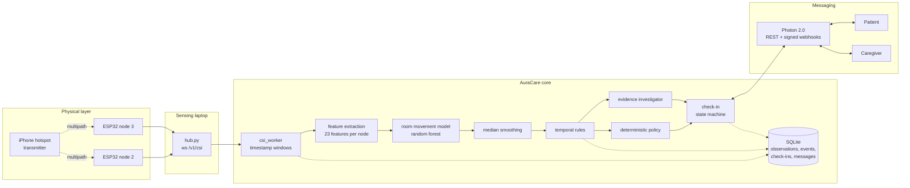
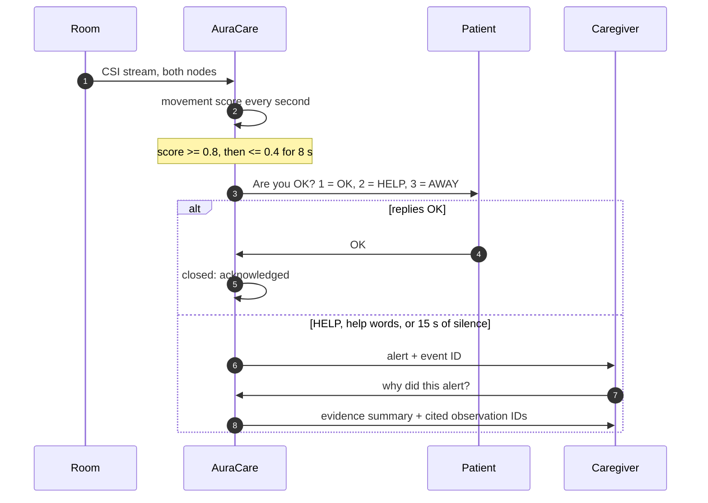

<div align="center">

# AuraCare

### Checks on patients using the Wi-Fi waves already in the room.

*No cameras. No microphones. No wearables. Just radio, physics, and a text message.*


**HackPrinceton Fall 2026**

</div>

---

Every Wi-Fi router fills a room with radio waves. Those waves bounce off walls, furniture and people before they
reach a receiver. When a person moves, the bounces change, and the change is measurable down to the individual
frequencies inside the signal.

**AuraCare reads those changes.** Two ESP32 boards listen to the room's Wi-Fi, a model trained in that room turns
the signal into a live movement score, and a set of temporal rules watches for one specific pattern: **a burst of
movement followed by stillness.** When it sees that, AuraCare doesn't sound an alarm. It asks:

> **AuraCare check-in (test):** we noticed an unusual movement pattern. Are you OK?
> Reply 1 = OK, 2 = HELP, 3 = AWAY

Reply "OK" and the check-in closes. Ask for help, or stay silent, and the caregiver's phone lights up with the
event and the evidence behind it. The caregiver can text back *"why did this alert?"* and get an answer built
only from recorded sensor data, with the IDs of the measurements it used.

> [!NOTE]
> AuraCare is a research prototype, tested only with consenting teammates and fictional patients. It is not a
> medical device and makes no fall-detection, clinical or diagnostic claims. It asks. It never diagnoses.

---

## Contents
1. [The signal path](#1-the-signal-path)
2. [Architecture](#2-architecture)
3. [Inside the pipeline](#3-inside-the-pipeline)
4. [Results](#4-results)
5. [Fail-safe by design](#5-fail-safe-by-design)
6. [Tech stack](#6-tech-stack)
7. [Quickstart](#7-quickstart)
8. [Running the demo](#8-running-the-demo)
9. [API](#9-api)
10. [Repository map](#10-repository-map)
11. [Limitations and roadmap](#11-limitations-and-roadmap)
12. [Credits](#12-credits)

---

## 1. The signal path

```
        ))) ))) )))                                                  ┌──────────────┐
   ┌──────────────┐    2.4 GHz, ch 6, 20 MHz     ┌──────────────┐    │  64 complex  │
   │  iPhone 15   │  ~~~~~~~~~~~~~~~~~~~~~~~~~>  │ ESP32 node 2 │───>│ subcarriers  │──┐
   │  Pro hotspot │  ~~~~~~ bounce off  ~~~~~~>  └──────────────┘    │ per packet   │  │
   │  (room ctr)  │  ~~~~~~ walls, people ~~~~>  ┌──────────────┐    └──────────────┘  │
   └──────────────┘  ~~~~~~~~~~~~~~~~~~~~~~~~~>  │ ESP32 node 3 │───> same, ~29/s ─────┤
                                                 └──────────────┘                      │
                                                                                       v
   ┌───────────┐   ┌────────────────┐   ┌──────────────────┐   ┌───────────────┐   ┌────────┐
   │ iMessage  │<──│ check-in state │<──│ policy: opt-in,  │<──│ burst then 8s │<──│ P(move)│
   │ patient + │   │ machine (15 s) │   │ sensor fresh, no │   │ stillness rule│   │ 1 Hz   │
   │ caregiver │   └────────────────┘   │ open check-in    │   └───────────────┘   └────────┘
   └───────────┘                        └──────────────────┘
```

Each packet carries the **channel state information (CSI)** of 64 OFDM subcarriers: one complex number per
frequency, describing how much that slice of the signal was weakened and shifted on its way across the room.
A person walking through the room disturbs those numbers. A person lying still barely touches them.

## 2. Architecture





## 3. Inside the pipeline

### 3.1 Decoding the radio
Almost every packet arrives as 256 signed bytes (802.11n): an L-LTF block and an HT-LTF block, each holding 64 subcarriers as
`[imag, real]` pairs. AuraCare takes the L-LTF block (`raw[0:128]`) and rebuilds the complex channel:

$$H_k = \text{real}_k + j \cdot \text{imag}_k, \qquad k \in \{0..31,\ -32..-1\}$$

It then drops the DC and guard subcarriers (12 of them) and reorders the remaining 52 into frequency order
$[-26..-1,\ +1..+26]$. The order was verified, not assumed: a lag-2 phase-continuity test compares the phase jump
across the middle of the band against the typical jump between neighbours. The correct layout won on
**26 out of 26** node recordings.

### 3.2 Surviving real hardware
Spec sheets said 45 to 50 packets per second. We measured the room instead:

| Signal property | Measured |
|---|---|
| Packets delivered per node | **~29 / s** |
| Packets lost in transit (sequence gaps) | **~34%** |
| Longest gap | **0.8 s** |
| Packets with subcarriers 0 and +1 zeroed by the chip | **100%** |

So nothing in AuraCare assumes a fixed rate. Every window is cut from laptop receive timestamps, checked with
sequence numbers, and interpolated onto a 50 Hz grid:

- **length:** 2.96 s (148 samples)
- **coverage:** at least 60% of the expected packets
- **max gap:** 0.3 s, otherwise the window is discarded and nothing is inferred

The zeroed subcarrier +1 is filled from its neighbour instead of feeding the model a fake zero.

### 3.3 Turning waves into motion
For each node and each window, AuraCare computes 23 motion features from the amplitude matrix
$X \in \mathbb{R}^{148 \times 52}$:

| Family | What it captures |
|---|---|
| Subcarrier spread | how much each frequency fluctuates over the window |
| Step energy | $\lvert X_{t+1} - X_t \rvert$: how violently the channel changes between samples |
| Energy timing | where in the 3 s the motion peaks, and early vs late energy |
| Principal component | share of variance in the dominant motion direction (SVD) |
| Spectral bands | power of that component in 0.3-1, 1-2, 2-4, 4-8 and 8-20 Hz bands |
| Robust z-scores | fraction of samples far outside the window's own median |

No absolute signal level is used, so the model reacts to *movement*, not to where the boards happen to sit.

### 3.4 The movement score
Both nodes' features are concatenated (46 values) and passed to a random forest trained on recordings of this
exact room. The output is one number per second:

$$s_t = P(\text{moving} \mid \phi(X^{(2)}_t) \oplus \phi(X^{(3)}_t)), \qquad \tilde{s}_t = \text{median}(s_{t-2},\ s_{t-1},\ s_t)$$

### 3.5 The temporal rule
An alert is a shape in time, not a single prediction:

$$\exists\, t_0:\ \tilde{s}_{t_0} \ge 0.8 \quad\text{and}\quad \tilde{s}_t \le 0.4\ \ \forall\, t \in [t_1,\ t_1 + 8\,\text{s}],\ t_1 > t_0$$

with no return to movement in between. If the sensor feed goes stale, the detector resets: **missing data is
never treated as stillness.**

### 3.6 The decision layer
A deterministic policy, not a model, decides whether a human gets a message. Before texting anyone it checks
that the sensor is fresh, the participant opted in, the event source is allowed, and no check-in is already open.

| Patient reply | Outcome |
|---|---|
| `OK` / `1` | closed as *acknowledged* (an acknowledgment, not proof of safety) |
| `HELP` / `2`, or "fell", "hurt", "can't get up", "dizzy"... | caregiver alerted |
| `AWAY` / `3` | closed as *away* |
| anything else | *ambiguous*: caregiver asked to review, check-in stays open |
| no reply in 15 s | caregiver alerted |
| message undeliverable | caregiver alerted |

### 3.7 The evidence investigator
Every event gets a report assembled only from stored numbers: sensor health, activity 30 s before and after,
signal coverage, the check-in timeline. Every sentence cites the observation IDs it came from. Caregiver
questions are routed by keyword to the right part of that report. **There is no language model anywhere in the
loop, so there is nothing to hallucinate.**

### 3.8 Messaging
Outbound: four Photon 2.0 REST calls (resolve user, find their assigned iMessage line, open the direct space,
send) with idempotency keys, so a retry can never double-text. Inbound: Standard Webhooks signatures
(HMAC-SHA256 over `id.timestamp.body`, 5 minute window, secret rotation supported) verified before a single byte
is processed. Recipients are resolved by role from server config: no code path can text an arbitrary number.

## 4. Results

### 4.1 Public benchmark: WiFall
Five activities (fall, jump, sit, stand, walk), 926 usable 3 s clips, 10 participants.
**Leave-one-participant-out**: every score is on a person the model has never seen.

| Model | 5-class macro-F1 | Fall vs rest bal. acc | Fall precision |
|---|---|---|---|
| Majority baseline | 0.13 | 0.50 | - |
| Random forest, handcrafted features | 0.41 | 0.69 | 0.76 |
| 1D CNN | 0.49 | 0.78 | 0.87 |
| **RF + CNN ensemble** | **0.51** | **0.78** | **0.86** |

**Split conformal prediction** on the ensemble ($\alpha = 0.1$): coverage **91.5%**, average set size 2.85, and
"fall" inside the prediction set for **94.6%** of real falls. If the set holds more than one label, the model
abstains.

### 4.2 Our room
13 one-minute recordings: empty room, one and two people still, one and two people moving, plus sit-down /
stand-up and jump sessions driven by **28 spoken, timestamped prompts**.

**The WiFall model did not transfer.** New hardware, new room, new sampling rate. In the empty room it ranked
"fall" first in 23% of windows and never committed to a single label. It is kept as a benchmark and is **never
used for alerts**.

**A model trained in the room did.** Train on recording 1 of each state, test on recording 2, then swap:

| Held-out task | Balanced accuracy |
|---|---|
| Moving vs still / empty | **0.84** |
| Occupied vs empty | 0.81 |
| People count (0 / 1 / 2) | 0.64 |
| Exact state (5 classes) | 0.57 |

| Alert rule on held-out score streams | Result |
|---|---|
| Movement detected after prompted actions | **28 / 28** |
| False alerts across all 13 recordings, including every sit-down and jump | **0** |

People counting at 0.64 is too weak to act on, so it is never allowed to cancel an alert.

## 5. Fail-safe by design

24 automated tests, one or more per rule:

| Guarantee | Tests |
|---|---|
| Stale or offline sensor = "unavailable", never "person is still"; gaps reset the detector | `test_stale_sensor_*`, `test_gap_resets_detector` |
| Replayed or synthetic data never texts anyone outside demo mode; no opt-in, no message | `test_replay_*`, `test_no_opt_in_*`, `test_room_replay_is_demo_only` |
| One check-in per event; duplicate webhooks and sends ignored | `test_abrupt_*`, `test_duplicate_webhook_ignored` |
| OK acknowledges; help words escalate; free text never closes a check-in | `test_ok_*`, `test_help_*`, `test_mixed_*`, `test_ambiguous_never_closes` |
| Timeouts and delivery failures escalate | `test_timeout_escalates`, `test_delivery_failure_recorded` |
| Webhooks need a valid, fresh signature; rotation works; own messages ignored | `test_unknown_sender_and_bad_signature`, `test_signature_rotation_and_stale_timestamp`, `test_own_agent_message_ignored` |
| Reports cite only real IDs; caregiver answers are grounded; replays are labelled | `test_report_*`, `test_stale_sensor_report_*`, `test_caregiver_question_gets_grounded_answer`, `test_replay_labelled` |
| Activity labels attach to events only after live validation | `test_ml_only_attached_after_validation` |
| Windows follow the real packet rate; layout check survives the zeroed subcarrier | `test_window_*`, `test_lag2_*` |

**Privacy:** no video, no audio, no MAC addresses, phone numbers only in a local `.env`, every message labelled
as a test, consenting teammates only.

## 6. Tech stack

| Layer | Technology | Role |
|---|---|---|
| Radio | iPhone 15 Pro hotspot, 2.4 GHz ch 6, 20 MHz HT | transmitter |
| Sensors | 2x ESP32-WROOM-32 DevKit V1, RuView firmware | CSI capture, 64 subcarriers per packet |
| Edge | RuView hub, WebSocket `/v1/csi` | raw packet stream with timestamps and sequence numbers |
| Signal processing | NumPy, SciPy | subcarrier mapping, timestamp windowing, interpolation, SVD, FFT |
| Machine learning | scikit-learn (random forest), PyTorch (1D CNN) | room movement score; WiFall benchmark ensemble |
| Uncertainty | split conformal prediction | calibrated prediction sets and abstention |
| Backend | FastAPI, Uvicorn, SQLite | ingestion, rules, policy, check-ins, evidence store |
| Reasoning | deterministic investigator + keyword reply parser | grounded caregiver answers, no LLM |
| Messaging | Photon 2.0 REST API, Standard Webhooks | iMessage check-ins and replies |
| Networking | Cloudflare Tunnel | public HTTPS for webhooks |
| Testing | pytest | 24 safety and correctness tests |

## 7. Quickstart

Python 3.10+ on macOS or Linux.

```bash
git clone https://github.com/NullPranaya/Wi-Fall.git && cd Wi-Fall
python -m venv .venv && source .venv/bin/activate
pip install -r requirements.txt
cp .env.example .env
cp models/room_calibration.json calibration.json
pytest -q
```

| `.env` variable | Meaning |
|---|---|
| `PATIENT_ADDRESS`, `CAREGIVER_ADDRESS` | test phone numbers, E.164 (`+1...`) |
| `PARTICIPANT_OPT_IN` | must be `1` before anyone is messaged |
| `DEMO_MODE` | `1` lets replayed or synthetic events text test numbers |
| `EXPECTED_ACTIVE` | `0` for the demo: a quiet room alone never triggers a text |
| `CHECKIN_TIMEOUT_S` | seconds before silence escalates to the caregiver (demo: 15) |
| `PHOTON_MODE` | `mock` logs messages, `api` sends them |
| `PHOTON_PROJECT_ID`, `PHOTON_PROJECT_API_KEY` | from the Photon dashboard |
| `PHOTON_WEBHOOK_SECRET` | the `whsec_...` secret from the webhook destination |

**Photon in four steps**
1. Dashboard: copy the **Project id**, create an **API key**.
2. **iMessage > Add someone to the line** for both phones. Each phone texts its assigned line once.
3. `cloudflared tunnel --url http://127.0.0.1:8000`, then **Webhooks > Add a destination** with
   `<tunnel url>/webhooks/photon` and all events. Save the secret.
4. `PHOTON_MODE=api`, restart the backend.

## 8. Running the demo

```bash
# terminal 1: backend
uvicorn backend.main:app --host 127.0.0.1 --port 8000

# terminal 2: public URL for replies (update the Photon webhook if it changes)
cloudflared tunnel --url http://127.0.0.1:8000

# terminal 3, pick one
python -m monitoring.csi_worker --hub ws://<hub laptop>:8770/v1/csi                          # live boards
python -m monitoring.csi_worker --replay <room dataset> --chunks p1_moving_1,p1_still_1      # recorded room
python -m monitoring.csi_worker --synthetic                                                  # labelled fallback
```

Live output, one line per second:
```
16:30:07 score 0.81 smoothed 0.81 MOVING
16:30:09 score 0.38 smoothed 0.44 still
16:30:12 score 0.13 smoothed 0.13 still
16:30:18 score 0.06 smoothed 0.07 still
  EVENT evt_2d4bd46da8 abrupt_motion_then_inactivity {'action': 'routine_checkin', ...}
```

Reproduce every number in this README:
```bash
python -m ml.data data/raw/WiFall data/clips.npz
python -m ml.train_rf data/clips.npz --rate 50 && python -m ml.train_cnn && python -m ml.evaluate
python -m ml.eval_auracare <room dataset>      # WiFall model in our room
python -m ml.eval_room <room dataset>          # held-out room models
python -m ml.room_motion train <room dataset>  # deployed movement model
```

## 9. API

| Method | Path | Purpose |
|---|---|---|
| `POST` | `/ingest/observation` | one movement score (from the worker) |
| `POST` | `/ingest/ml` | latest activity-model window (experimental) |
| `GET` | `/sensors/{id}/health` | is the feed fresh and ready |
| `GET` | `/sensors/{id}/baseline` | active detector thresholds |
| `GET` | `/activity/history` | recent movement scores |
| `GET` | `/events`, `/events/{id}` | events with evidence IDs and policy decision |
| `GET` | `/events/{id}/checkin` | check-in state and timeline |
| `GET` | `/events/{id}/investigations` | evidence reports |
| `POST` | `/checkins`, `/investigate` | policy-checked manual check-in, re-run investigation |
| `POST` | `/webhooks/photon` | signed inbound iMessage events |

Interactive docs at `http://127.0.0.1:8000/docs`.

## 10. Repository map

```
backend/         FastAPI app, settings, SQLite store, service layer
monitoring/      csi_worker (live / replay / synthetic), temporal rules, policy, calibration
sensors/         subcarrier mapping, layout checks, timestamp windowing, sensor health
ml/              WiFall pipeline (RF, CNN, conformal), room dataset loader, room movement model, evaluations
investigation/   evidence investigator and grounded caregiver answers
photon/          Photon 2.0 client, webhook verification, check-in state machine, reply parser
models/          room movement model, calibration, conformal threshold
evaluation/      saved metrics behind every number above
sim/             WiFall replay sensor
tests/           24 tests
```

## 11. Limitations and roadmap

**Honest limits**
- **No real falls were recorded.** The alert rule is validated on recorded movement-to-stillness transitions and
  28 prompted sit / stand / jump actions, not on falls.
- **One room, one session.** Held-out recordings were minutes apart, so the numbers are likely optimistic.
  A new room needs a short recording and a retrain.
- **Lossy radio.** A third of packets never arrive on two nodes.

**Next**
- multi-day recordings, furniture changes, more rooms
- per-person routines instead of fixed thresholds
- presence and people-count from the hub as investigator context
- a caregiver dashboard over the event and check-in timeline

## 12. Credits

- [WiFall](https://github.com/RS2002/WiFall): public CSI activity dataset used for the benchmark
- [RuView](https://github.com/ruvnet/RuView): ESP32 CSI firmware and sensing server
- [Photon](https://photon.codes): iMessage messaging API
- NumPy, SciPy, scikit-learn, PyTorch, FastAPI, Uvicorn, pytest
