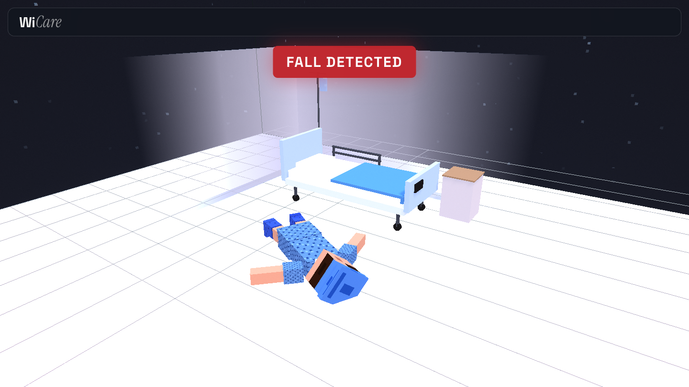
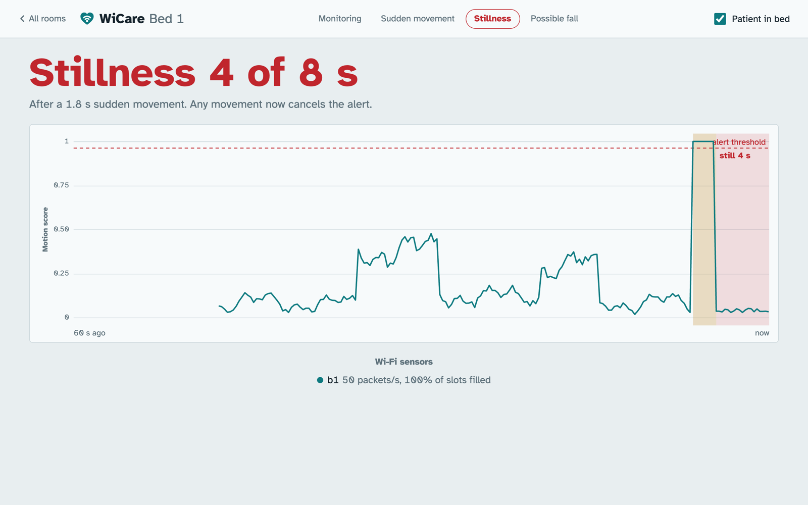
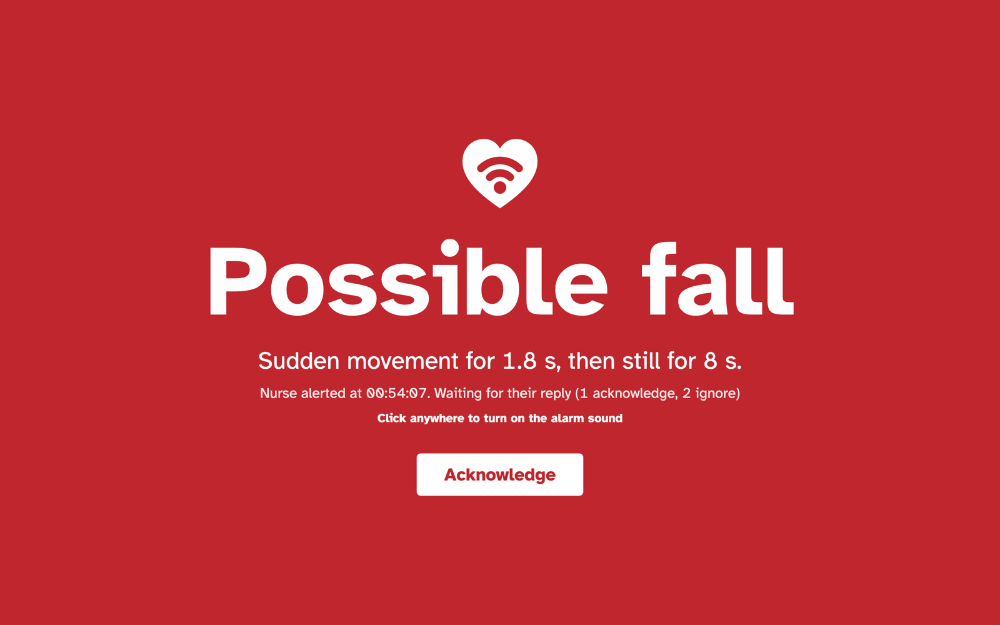
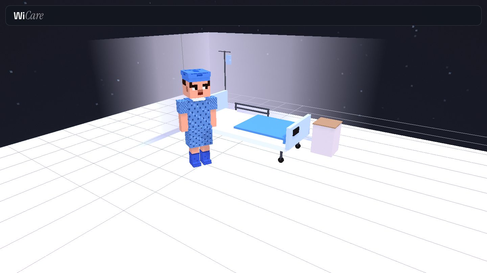

<div align="center">


# WiCare

### Uses Wi-Fi waves to detect when a patient falls, without using a camera, and texts the nurse.

**HackPrinceton Fall 2026 · Photon track**



</div>

---

## What it does

WiCare uses the Wi-Fi waves already in a hospital room to notice abnormal movement, like a patient falling to
the floor. There is no camera in the room and nothing for the patient to wear.

When a person moves, the Wi-Fi signal in the room changes. A fall changes it in a specific way: a sudden burst
of movement, then stillness. WiCare watches for that pattern. When it sees one, it texts the nurse through
[Photon](https://photon.codes) (iMessage) and asks what to do. If the nurse wants to look, one reply opens a 3D
view of the room.

### 1. WiCare watches the Wi-Fi signal

The monitor shows how much the signal in Bed 1's room is changing, four times a second. Here it has just seen a
sudden movement and is counting the stillness that follows.



### 2. It raises the alarm and texts the nurse

After 8 seconds of stillness the monitor turns red and the nurse gets this text on their phone:

> WiCare: possible fall detected at 00:54:07. Patient has been still for 8 s after a sudden movement.
> Reply 1 to acknowledge, 2 to ignore.



### 3. The nurse replies, and the room opens

- Reply **1**: the screen opens the room view below, so the nurse can see what happened.
- Reply **2**: the alert is dismissed as a false alarm.

The room stays private until the nurse asks to see it. Before that, the screen shows only a line on a chart.

| Just before | After the fall |
|---|---|
|  |  |

## How it detects a fall from Wi-Fi

```
  Wi-Fi router ))) ~~ signal bounces off walls, furniture and the patient ~~ ))) ESP32 board(s)
                                                                                  │ motion score, 4 times a second
                                                                                  ▼
       nurse's phone <── Photon iMessage <── fall rule <── WiCare monitor (live chart, Bed 1)
            │ replies 1
            ▼
       3D room view opens on the monitor screen
```

**1. The signal.** A Wi-Fi signal is not one wave. It is split across dozens of narrow frequency channels
(subcarriers), and each one reaches the receiver along many paths: straight across the room, off the walls, off
the bed, off the person. A small ESP32 board can report how strong each subcarrier arrived, packet by packet.
This is called channel state information (CSI).

**2. Movement.** In an empty or still room those readings barely change. When a body moves, the paths that bounce
off it change length, and the subcarriers rise and fall in a pattern. Bigger and faster movement means bigger
swings. The boards run ESPectre firmware, which turns those swings into a single **motion score**, sent to WiCare
four times a second. No image, no audio and no identity is ever captured, only how much the signal is changing.

**3. The shape of a fall.** Walking keeps the score high for a long time. Rolling over in bed is a small bump.
A fall is different: **a sharp burst, then nothing.** WiCare's rule looks for exactly that:

| Step | What WiCare looks for | On the monitor |
|---|---|---|
| Burst | score above the alert line (0.962) for at most 3 s | Sudden movement |
| Stillness | score stays below the line for 8 s | Stillness |
| Alert | both happened, in that order | Possible fall, text sent |

Movement that lasts longer than 3 s is treated as someone up and about, and never alerts.

**4. More than one board.** With two boards in the room, a burst only counts if **every** board sees it, so one
noisy sensor cannot raise an alarm on its own.

**5. Failing safe.** If a board goes quiet for more than 1.5 s, the monitor says **No signal** instead of
guessing. Missing data is never counted as stillness. A "Patient in bed" switch turns alerts off when the bed is
meant to be empty.

**6. The text and the reply.** WiCare sends the alert through Photon's iMessage API, then keeps reading the
conversation for the nurse's answer. **1** opens the room view on the monitor screen; **2** clears the alarm and
logs a false alarm.

**7. The room view.** A 3D room: hospital bed, the patient in a gown falling to the floor, and **FALL DETECTED**
across the top.

### What about vitals?

WiCare does not measure vital signs today. The same Wi-Fi readings can carry them, because breathing moves the
chest a few millimetres at a steady rhythm and that shows up as a slow, regular ripple in the signal. Reading
breathing rate from that ripple, and alerting when it changes, is the next thing we want to build.

## Run it

Everything runs from one laptop with one command.

```bash
python -m venv .venv && source .venv/bin/activate
pip install -r requirements.txt
cp .env.example .env          # then fill in the Photon values below
python run.py --boards        # reads the ESP32 boards listed in wicare/fallguard/.env
```

| What | Where |
|---|---|
| Monitor | `http://localhost:8000/` |
| All rooms | `http://localhost:8000/ward` |
| Room view (opens by itself on reply 1) | `http://localhost:8000/room` |

In `.env`: `CAREGIVER_ADDRESS` (the nurse's phone, like `+15551234567`), `PHOTON_PROJECT_ID` and
`PHOTON_PROJECT_API_KEY`. The nurse's phone must have texted the Photon line once, so Photon is allowed to
message it. Node.js is needed for the sender (`wicare/fallguard/notify/send.mjs`).

Without boards, `python run.py` runs the monitor on a simulated signal, so the alert, the text, the reply and the
room view can all be tried without hardware.

After an alert, WiCare holds the alarm until the nurse replies or someone presses Acknowledge.

## What is in this repository

```
run.py           starts everything: WiCare's app and the room view
wicare/          the team's WiCare app, exactly as in github.com/duna-akin/WiCare:
                 monitor dashboard, ward page, board reader, fall rule, Photon sender, reply reader
frontend/        the 3D room view (index.html?room=1): bed, patient, fall, built on three.js
remote/          simulated board signal, for running without hardware
backend/ ml/ monitoring/ photon/ sensors/ investigation/ sim/ evaluation/ models/ tests/
                 our earlier research code (models trained on raw Wi-Fi recordings and a first messaging
                 pipeline); not used by run.py
```

## Honest limits

- This is a hackathon prototype, tested with teammates only. It is not a medical device.
- The fall rule is simple on purpose: one threshold and two timers, tuned in one room.
- The 3D room view is an animation that plays when the nurse opens the room. It is not reconstructed from the
  Wi-Fi signal.
- Beds 2 to 6 on the ward page are simulated by the dashboard; Bed 1 is the live one.
- The pictures above were taken with the simulated signal, not with boards in the patient's room

## Credits

- [WiCare](https://github.com/duna-akin/WiCare): monitor dashboard, ward page, fall rule and Photon messaging
- [Photon](https://photon.codes): iMessage API
- ESPectre: ESP32 Wi-Fi motion sensing firmware
- [RuView](https://github.com/ruvnet/RuView) (MIT): the 3D scene the room view started from
- [three.js](https://threejs.org), FastAPI, Uvicorn
